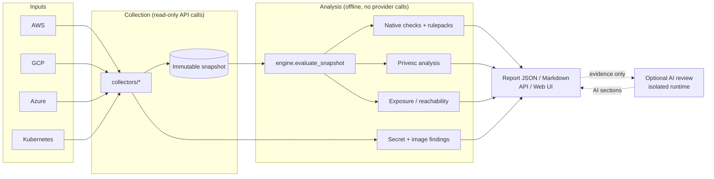

# PEASO CSPM documentation

PEASO CSPM (package name `hacktricks-cspm`) is a read-only cloud security posture scanner.
It reads configuration from AWS, Google Cloud, Azure and Kubernetes, saves what it read as an
immutable snapshot, and then evaluates that snapshot offline.

The evaluation produces:

- **Native checks**: deterministic hardening, exposure, least-privilege, IAM-graph and network checks.
- **Framework views**: native results grouped under compliance frameworks (CIS, NIST, PCI DSS, SOC 2 and others).
- **Privilege escalation analysis**: paths from one identity to more power, based on a catalog of techniques.
- **Network and internet exposure analysis**: which assets look reachable from the internet, and selected private flows.
- **Secret and image findings**: optional content scans for leaked secrets and container image CVEs.
- **AI review** (optional): model-assisted network architecture review and a prioritized "Top actions" list.
- **Attack detection** (optional): detection rules run over audit logs that the scanner reads.

You can use it three ways:

1. **CLI** (`peaso` or `hacktricks-cspm`) on your own machine, with your own credentials.
2. **Local web app**: a FastAPI server plus a React frontend, usually run with Docker Compose.
3. **Hosted AWS deployment**: the same server and workers on Lambda, Step Functions and ECS Fargate, defined in `infra/aws`.

## Architecture at a glance

The key design rule is the split between **collection** and **analysis**. Only collectors talk to
cloud providers, and they only use read-style APIs. Everything after the snapshot is pure,
repeatable computation: the same snapshot always gives the same native results.

## Documentation map

| Page | What it covers |
| --- | --- |
| [getting-started.md](getting-started.md) | Install, first CLI scan, demo mode, local web app with Docker |
| [permissions.md](permissions.md) | Read-only access each provider needs, and what is never needed |
| [architecture.md](architecture.md) | Code layout, data flow, snapshot and report formats, workers |
| [collectors.md](collectors.md) | How provider collectors work, scopes, limits, caches, statuses |
| [checks.md](checks.md) | Native checks, statuses, writing a check, observed-evidence rules |
| [compliance.md](compliance.md) | Framework catalog, mappings and what "supported" means |
| [privesc.md](privesc.md) | Privilege escalation catalog and analysis engine |
| [network-and-exposure.md](network-and-exposure.md) | Internet exposure, reachability, network graphs, trust |
| [secrets-and-images.md](secrets-and-images.md) | Secret scanning, private secret evidence, image CVE scanning |
| [ai-review.md](ai-review.md) | Optional AI stages, providers, isolation and credentials |
| [attack-detection.md](attack-detection.md) | Audit-log based detections |
| [frontend.md](frontend.md) | React app pages and development workflow |
| [api.md](api.md) | HTTP API, authentication, workspaces, API keys |
| [hosted-deployment.md](hosted-deployment.md) | AWS hosted deployment with Terraform |
| [testing.md](testing.md) | Running tests locally and in CI |
| [configuration.md](configuration.md) | Environment variable reference |

## Legacy IAM tools

The repository also ships the original Blue-CloudPEASS scripts: `Blue-AWSPEAS.py`,
`Blue-GCPPEAS.py`, `Blue-AzurePEAS.py` and `Blue-K8sPEAS.py` (package `bluepeass/`). They
produce IAM / RBAC reports and are separate from the `peaso` scanner described here.

## Important limits

The scanner states these limits in every report, and you should keep them in mind:

- Framework mappings are thematic links to reviewed upstream sources. They are **not** a compliance certification.
- Declared IAM relationships are not proof of effective access.
- Network inventory relationships are not proof that traffic can flow. No traffic is ever sent.
- A result of `UNKNOWN` means some needed evidence was missing; it is not a pass.

## Best practices

- Start with `peaso scan --demo` to learn the report shape before using real credentials.
- Use a dedicated read-only identity for scanning, as described in [permissions.md](permissions.md).
- Keep snapshots (`--snapshot-output`) so you can re-evaluate and diff later without new cloud calls.
- Treat `UNKNOWN` and `DENIED` results as coverage gaps to fix, not as passes.
- Read framework results as guidance, not as an audit opinion.
