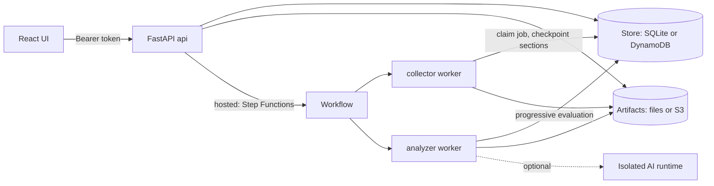

# Architecture

This page explains how the code is organized, how data moves through a scan, and the formats
it produces.

## Core idea: collect once, analyze offline

A scan has two halves:

1. **Collection** reads the cloud with read-only API calls and writes an immutable **snapshot**.
2. **Analysis** reads only the snapshot and produces a **report**. It never calls a provider.

Because analysis is deterministic, the same snapshot always gives the same native results. You
can re-run analysis with different selectors, compare two reports, or test checks with saved
snapshots and fixtures.

```text
 credentials + scopes + options
            │
            ▼
 ┌─────────────────────┐   read-only SDK/REST calls   ┌──────────────┐
 │ collectors/<prov>.py │ ───────────────────────────▶ │ Cloud APIs   │
 └─────────┬───────────┘                              └──────────────┘
           │ collection envelopes (status per type/scope)
           ▼
   snapshot (schema 1.0, snapshot_id = sha256 of content)
           │
           ▼
 ┌──────────────────────────────────────────────────────────────┐
 │ engine.evaluate_snapshot                                     │
 │  ├─ native checks (peaso/checks)        → PASS/FAIL/UNKNOWN… │
 │  ├─ analysis checks (peaso/analysis)    → exposure, coverage │
 │  ├─ privesc (peaso/privesc)             → paths, graph       │
 │  ├─ graphs (IAM, network, privesc)                           │
 │  └─ framework mapping (peaso/rulepacks)                      │
 └─────────┬────────────────────────────────────────────────────┘
           ▼
   report (schema 1.1) ──▶ CLI file / API / web UI / optional AI review
```

## Code layout

| Path | Purpose |
| --- | --- |
| `peaso/cli.py` | Command-line interface (`scan`, `collect`, `evaluate`, `report`, `diff`, `catalog`) |
| `peaso/engine.py` | Collection planning, snapshot evaluation, report compaction/expansion, diff, catalog |
| `peaso/collectors/` | Provider collectors (`aws.py`, `gcp.py`, `azure.py`, `k8s.py`), shared `base.py`, per-scan caches |
| `peaso/checks/` | Native check registry, fact helpers, fixtures and provider check modules |
| `peaso/rulepacks/` | Static JSON catalogs: native check metadata, frameworks, compliance lookup, remediation text, descriptions |
| `peaso/analysis/` | Cross-resource analysis: internet exposure, reachability, principal exposure, coverage, trust, graph projection |
| `peaso/privesc/` | Privilege escalation technique catalog (YAML) and evaluator |
| `peaso/attack_detection/` | Audit-log normalization and detection rules |
| `peaso/ai/` | Optional AI review stages, agent definitions, provider access |
| `peaso/server/` | FastAPI app, request validation, Lambda and scheduler handlers |
| `peaso/worker.py` | Collector and analyzer worker processes |
| `peaso/storage/` | SQLite + files (local) or DynamoDB + S3 (hosted) persistence |
| `peaso/auth/` | Identity, API keys, credential encryption |
| `frontend/` | React web app (Vite, TypeScript) |
| `infra/aws/` | Terraform for the hosted deployment and the customer role template |
| `scripts/` | Deploy, catalog sync/validation, compliance build and CI helper scripts |
| `tests/` | Pytest suite |
| `bluepeass/`, `Blue-*PEAS.py` | Legacy IAM / RBAC report tools |

## Snapshots

A snapshot is a JSON document with these top-level fields:

- `schema_version` (currently `1.0`), `provider`, `scopes`, `created_at`, `metadata`.
- `collections`: a list of **envelopes**. Each envelope covers one resource type in one scope
  and records a status (`collected`, `empty`, `partial`, `denied`, `timeout`, `malformed`,
  `unknown`), an error code when relevant, and the resource items.
- `snapshot_id`: a SHA-256 over the content. Reports reference the snapshot by this ID.

Envelope statuses are what let checks tell "no resources" (`empty`) apart from "could not read"
(`denied`, `timeout`, `partial`). See [collectors.md](collectors.md).

## Reports

Report schema `1.1` keeps the report small by referencing native snapshot items instead of
copying them. `--embed-native` (or `engine.expand_report`) produces schema `1.0` with items
embedded. Important report fields:

| Field | Content |
| --- | --- |
| `findings` | Grouped findings per check, with observations per resource, status, severity, evidence summary |
| `finding_aggregates` | Per-check counts for `NOT_APPLICABLE` and `EMPTY` rows (unless `--include-not-applicable`) |
| `coverage` | What was collected, denied or missing |
| `graphs` | IAM, network and privilege-escalation graphs |
| `least_privilege` | Grant and principal summaries |
| `check_frameworks`, `framework_versions`, `manual_requirements` | Framework mapping data |
| `stats`, `snapshot_metadata`, `risk_model_version` | Summary and provenance |

Every report also includes a fixed list of **limitations** (framework mappings are not
certification; declared IAM is not effective access; network inventory is not proven
reachability; not every upstream catalog is ported).

## Categories

The engine knows these categories: `hardening`, `exposure`, `least_privilege`, `iam_graph`,
`network`, `privesc`, `monitoring`, `encryption`, `compliance`, `logging`, `identity`,
`recovery`, `vulnerability`, `threat_detection`, `secure_development`, `backup`,
`supply_chain`, `malware`, `asset_management`, `patch_management`. Native checks register in the
first five; the others group framework and analysis results. Run `peaso catalog` for the live list.

## Server, workers and storage



- The **API** validates requests, stores connectors (credentials encrypted with Fernet), queues
  scans and serves results.
- The **collector worker** (`python -m peaso.worker collector`) claims a queued scan with a lease,
  decrypts the connector, collects, and checkpoints sections so a scan can resume.
- The **analyzer worker** (`python -m peaso.worker analyzer`) evaluates from the stored snapshot.
  With `--progressive` it publishes results while collection is still running, so each part of
  the UI fills in as soon as its data is ready.
- **Local mode** uses `SQLiteStore` and files under the state directory; workers poll the store.
- **Hosted mode** uses DynamoDB and S3, and the API starts a Step Functions execution
  (`scan-<id>`) that runs both workers on ECS Fargate. See [hosted-deployment.md](hosted-deployment.md).

## Per-scan caching

Identical cloud reads inside one scan are cached so that several collectors needing the same
data do not repeat the call. Caches are scoped to one scan, bounded in memory, and do not keep
transient errors. Nothing is cached across scans.

## Best practices

- Keep provider calls inside collectors only; checks and analysis must stay pure functions of the snapshot.
- Treat snapshots as immutable inputs; produce a new snapshot instead of editing one.
- Use report schema 1.1 for storage and transfer; expand only when a consumer needs embedded items.
- Prefer the progressive analyzer so users see native results early and AI never blocks them.
