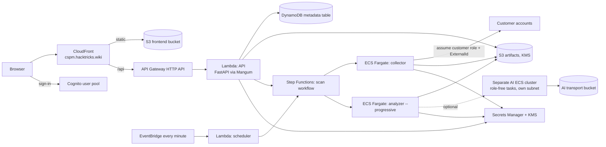

# Hosted AWS deployment

The hosted version runs the same server and workers as the local stack, but on managed AWS
services. Everything is defined in Terraform under `infra/aws/`, and `scripts/peaso_deploy.py`
builds and applies it.

## Architecture



| File | Resources |
| --- | --- |
| `versions.tf` | Terraform ≥ 1.14.3, AWS provider ~> 6.0, S3 backend, domain and Cognito locals |
| `frontend.tf` | S3 frontend bucket, CloudFront distribution, DNS |
| `api.tf` | API Lambda (`PEASO_AUTH_MODE=cognito`, DynamoDB storage), API Gateway, scheduler Lambda and EventBridge rule |
| `workflow.tf` | Collector and analyzer task definitions, Step Functions state machine |
| `storage.tf` | DynamoDB table, artifact and templates buckets, ECR worker repository, Secrets Manager secrets, KMS keys, customer role template objects |
| `iam.tf` | Roles for API, workers, workflow, and the collector role customers trust |
| `network.tf` | VPC, subnets, security group, S3 and DynamoDB endpoints, ECS cluster for workers |
| `ai_runtime.tf`, `ai_network.tf` | Isolated AI cluster, subnet, security group, NACL and transport bucket |
| `cost.tf` | AWS Budget alert (`monthly_budget_usd`, default 25) |
| `outputs.tf` | `url`, buckets, table, `workflow_arn`, `worker_repository`, `collector_role_arn`, … |
| `customer-role.json` | CloudFormation template customers deploy (see [permissions.md](permissions.md)) |

## How a hosted scan runs

1. The API stores the scan in DynamoDB and starts a Step Functions execution named `scan-<id>`.
2. The workflow runs the **collector** task (`python -m peaso.worker collector --once`) and the
   **analyzer** task (`python -m peaso.worker analyzer --progressive --once`) in parallel. The
   analyzer publishes results while collection continues.
3. The collector assumes the customer's role using the External ID and writes the snapshot and
   checkpoints to the artifact bucket.
4. The scheduler Lambda runs every minute: it expires stale work, starts due scheduled scans and
   dispatches queued scans.

Default task sizes: collector 4 vCPU / 16 GiB, analyzer 1 vCPU / 8 GiB (`worker_resources`).
Default time limits: 7200 seconds per workflow and per stage (`scan_runtime_limits`).

## Key variables

| Variable | Meaning |
| --- | --- |
| `region` | Deployment region (default `us-east-1`) |
| `account_id` | The only AWS account Terraform may touch |
| `api_zip`, `worker_image` | Built API package and worker image |
| `cognito_pool_id`, `cognito_client_id` | Existing Cognito user pool and app client |
| `worker_resources`, `scan_runtime_limits` | Fargate sizes and time limits |
| `budget_email`, `monthly_budget_usd` | Cost alerts |
| `codex_token_secret_arn` | Optional platform Codex token for AI |
| `gcp_platform_sa_secret_arn`, `gcp_platform_project`, `gcp_platform_email` | Optional GCP platform service account |
| `platform_account_ids` | Platform accounts that customers may not register as targets |
| `enable_public_customer_role_template` | Publish a public quick-create template URL (off by default) |
| `stripe_secret_arn`, `stripe_price_id` | Billing integration |

## Deploying

`scripts/peaso_deploy.py` wraps the build and Terraform steps. A typical run:

```bash
terraform -chdir=infra/aws init -backend-config=PATH/TO/backend.hcl

python scripts/peaso_deploy.py freeze-release
python scripts/peaso_deploy.py package-api
python scripts/peaso_deploy.py build-frontend
python scripts/peaso_deploy.py build-worker --tag TAG
python scripts/peaso_deploy.py push-worker --tag TAG
python scripts/peaso_deploy.py plan --image IMAGE --save-for-review --output plan.out
python scripts/peaso_deploy.py review-current-plan --plan plan.out
python scripts/peaso_deploy.py apply --plan plan.out --reviewed-sha256 SHA256_OF_REVIEWED_PLAN
python scripts/peaso_deploy.py publish-frontend --plan plan.out --reviewed-sha256 SHA256_OF_REVIEWED_PLAN
python scripts/peaso_deploy.py verify-host
```

`apply` and `publish-frontend` refuse to run unless the SHA-256 of the plan you reviewed matches,
so only an exact, reviewed plan is applied. `freeze-release` snapshots the current source first;
`package-api`, `build-worker` and the later steps refuse to run until it has. Other helpers:
`verify-package`, `validate-workflow`, `verify-resolved`, `review-successor-plan`,
`review-artifact-plan`. Run each with `--help` for its options.

## Security notes

- Connector credentials are encrypted with a Fernet key stored in Secrets Manager
  (`PEASO_CREDENTIAL_SECRET_ARN`); AI credentials use a separate key
  (`PEASO_AI_CREDENTIAL_SECRET_ARN`).
- The collector role is the only principal customers trust, and only with their External ID.
- AI tasks run in their own cluster and subnet with no task role, and receive evidence only
  through the transport bucket.
- Hosted connectors are restricted to auth methods that do not depend on the platform's own
  environment (see [permissions.md](permissions.md)) and to the hosted option limits in
  [collectors.md](collectors.md).

## Best practices

- Always save the plan, review it, and apply exactly that plan with its SHA-256.
- Keep Terraform state in a private, versioned, encrypted S3 backend.
- Set a budget email and a realistic `monthly_budget_usd`.
- Keep `enable_public_customer_role_template` off unless account-level S3 Block Public Access has been reviewed.
- Use `verify-host` after every deployment to confirm the site and API respond.
